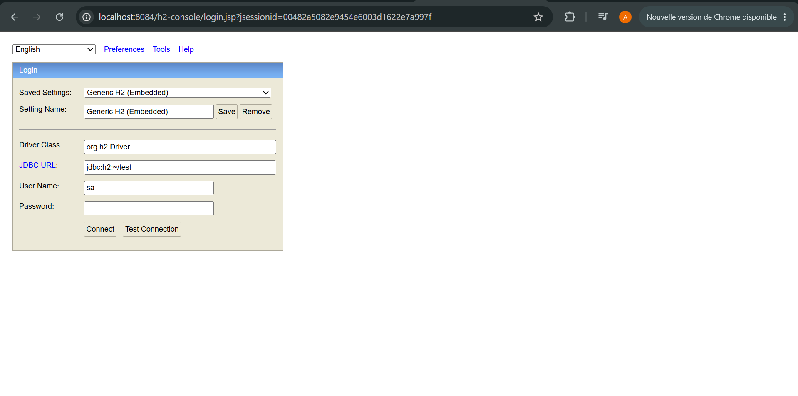
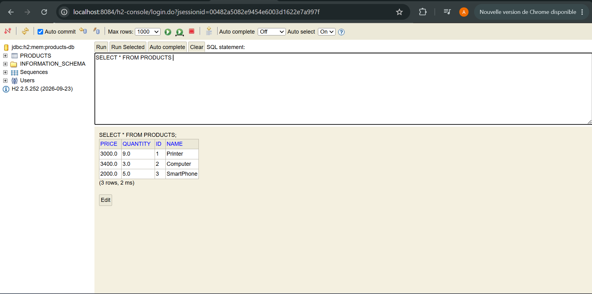
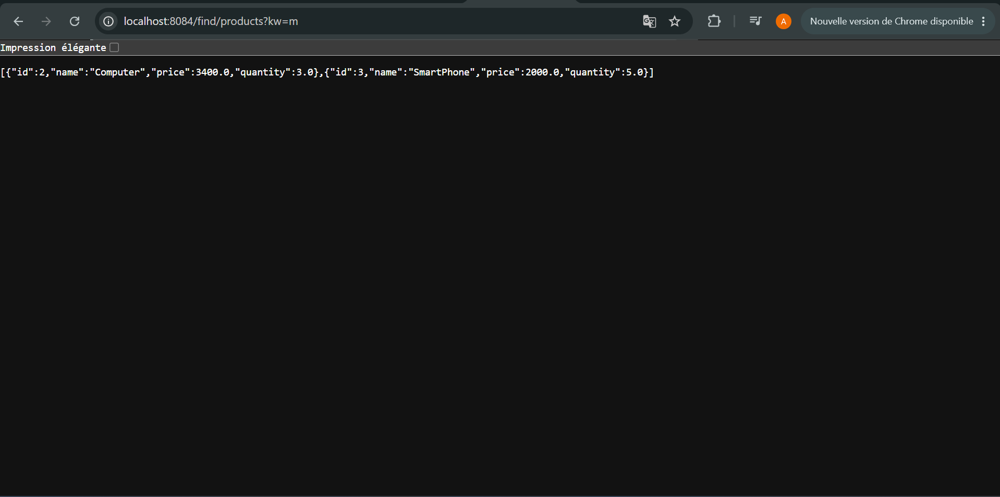

# demo-jpa-springdata

Compte rendu d'une démonstration de **JPA / Hibernate** et **Spring Data JPA** avec **Spring Boot** : persistance d'une entité `Product` dans une base H2 en mémoire, exposition via une API REST et consultation de la base avec la console H2.

## Sommaire

1. [Objectifs](#objectifs)
2. [Technologies](#technologies)
3. [Architecture du projet](#architecture-du-projet)
4. [Configuration](#configuration)
5. [Implémentation](#implémentation)
6. [Lancer le projet](#lancer-le-projet)
7. [Captures et résultats](#captures-et-résultats)
8. [Conclusion](#conclusion)

## Objectifs

- Mapper une classe Java vers une table relationnelle avec **JPA** (`@Entity`).
- Utiliser **Spring Data JPA** pour accéder aux données sans écrire de DAO (`JpaRepository`).
- Définir une requête dérivée du nom de la méthode (`findByNameContains`).
- Insérer des données de test au démarrage avec un `CommandLineRunner`.
- Exposer les données via un `@RestController`.
- Inspecter la base H2 grâce à la console web.

## Technologies

| Outil | Version / détail |
|---|---|
| Java | 21 |
| Spring Boot | 4.2.0 |
| Spring Data JPA / Hibernate ORM | Hibernate 7.4.15.Final |
| Spring Web MVC | API REST |
| Base de données | H2 (en mémoire), driver MySQL présent pour un usage ultérieur |
| Lombok | `@Getter`, `@Setter`, `@Builder`, etc. |
| Build | Gradle (wrapper inclus) |

## Architecture du projet

```
src/main/java/org/example/demojpaspringdata
├── DemoJpaSpringdataApplication.java   # point d'entrée + jeu de données initial
├── entities/
│   └── Product.java                    # entité JPA
├── repository/
│   └── ProductRepository.java          # interface Spring Data JPA
└── web/
    └── ProductRestController.java      # endpoints REST
src/main/resources/application.properties
captures/                               # captures d'écran du README
```

## Configuration

`src/main/resources/application.properties` :

```properties
spring.application.name=demo-jpa-springdata
spring.datasource.url=jdbc:h2:mem:products-db
spring.h2.console.enabled=true
server.port=8084
```

- Base H2 **en mémoire** nommée `products-db` : les données disparaissent à l'arrêt de l'application.
- Console H2 activée sur `/h2-console`.
- Application accessible sur le port **8084**.

## Implémentation

### Entité `Product`

```java
@Entity
@Table(name = "PRODUCTS")
@Getter @Setter @NoArgsConstructor @AllArgsConstructor @ToString @Builder
public class Product {
    @Id @GeneratedValue
    private Long id;
    private String name;
    private double price;
    private double quantity;
}
```

La table `PRODUCTS` est générée automatiquement par Hibernate à partir de l'entité (colonnes `ID`, `NAME`, `PRICE`, `QUANTITY`). Lombok génère accesseurs, constructeurs, `toString()` et le pattern *builder*.

### Repository

```java
public interface ProductRepository extends JpaRepository<Product, Long> {
    List<Product> findByNameContains(String kw);
}
```

`JpaRepository` fournit le CRUD (`save`, `findAll`, `findById`, …). `findByNameContains` est une **requête dérivée** : Spring Data la traduit en `WHERE name LIKE %kw%`.

### Données initiales

Dans `DemoJpaSpringdataApplication`, un bean `CommandLineRunner` insère trois produits au démarrage, en illustrant trois façons de créer un objet, puis affiche le contenu de la table dans la console :

| Méthode | Produit | Prix | Quantité |
|---|---|---|---|
| Setters | Computer | 3400 | 3 |
| Constructeur avec arguments | Printer | 3000 | 9 |
| Builder Lombok | SmartPhone | 2000 | 5 |

### API REST

| Méthode | URL | Description |
|---|---|---|
| GET | `/products` | Liste tous les produits |
| GET | `/products/{id}` | Retourne un produit par identifiant (exception `Product not found` s'il n'existe pas) |
| GET | `/find/products?kw=...` | Recherche les produits dont le nom contient `kw` (tous les produits si `kw` est vide) |

## Lancer le projet

Prérequis : JDK 21.

```bash
./gradlew bootRun        # Linux / macOS
gradlew.bat bootRun      # Windows
```

Puis ouvrir :

- API : <http://localhost:8084/products>
- Console H2 : <http://localhost:8084/h2-console>

## Captures et résultats

### 1. Connexion à la console H2



La console H2 est accessible sur `http://localhost:8084/h2-console`. Le formulaire propose par défaut l'URL `jdbc:h2:~/test` : il faut la remplacer par l'URL configurée dans l'application, `jdbc:h2:mem:products-db` (utilisateur `sa`, mot de passe vide), puis cliquer sur **Connect**.

### 2. Contenu de la table `PRODUCTS`



Après connexion, la requête `SELECT * FROM PRODUCTS;` retourne les 3 produits insérés par le `CommandLineRunner`. On constate que Hibernate a bien créé la table et généré les identifiants automatiquement :

| ID | NAME | PRICE | QUANTITY |
|---|---|---|---|
| 1 | Printer | 3000.0 | 9.0 |
| 2 | Computer | 3400.0 | 3.0 |
| 3 | SmartPhone | 2000.0 | 5.0 |

L'ordre d'insertion (Printer, Computer, SmartPhone) correspond à l'ordre des appels à `save()` dans le code.

### 3. Recherche par mot-clé via l'API



Requête : `http://localhost:8084/find/products?kw=m`

Réponse :

```json
[{"id":2,"name":"Computer","price":3400.0,"quantity":3.0},
 {"id":3,"name":"SmartPhone","price":2000.0,"quantity":5.0}]
```

Seuls `Computer` et `SmartPhone` sont retournés, car ils contiennent la lettre « m » ; `Printer` n'en contient pas, il est donc exclu. Cela valide le fonctionnement de la méthode dérivée `findByNameContains`.

## Conclusion

Ce projet montre la chaîne complète d'une application de persistance Spring Boot : entité JPA → repository Spring Data → contrôleur REST, le tout vérifié par la console H2 et le navigateur. Spring Data JPA permet d'obtenir un accès aux données complet avec très peu de code : aucune implémentation du repository n'est écrite et la requête de recherche est déduite du nom de la méthode.

Pistes d'amélioration :

- Utiliser `BigDecimal` pour le prix et `int` pour la quantité.
- Gérer les erreurs avec une exception dédiée (404) plutôt qu'une `RuntimeException`.
- Ajouter les opérations POST / PUT / DELETE.
- Basculer vers MySQL (driver déjà déclaré) avec une configuration dédiée.
- Compléter le test `contextLoads` par des tests du repository et du contrôleur.
